# lmbio

Gene circuits, enzymes, drugs, epidemics and molecular noise as reaction networks: stiff ODEs with CVODE, steady states with KINSOL, Gillespie SSA, SBML in and out, drawn with lmplot and lmdraw.

[](https://github.com/lmctl-ai/lmbio/actions/workflows/ci.yml)
[](https://github.com/lmctl-ai/lmbio/releases)
[](LICENSE)

### Gene circuits and noise

| Toggle switch: two memories | Repressilator: a ring that keeps time | Self-repression speeds response |
| --- | --- | --- |
| 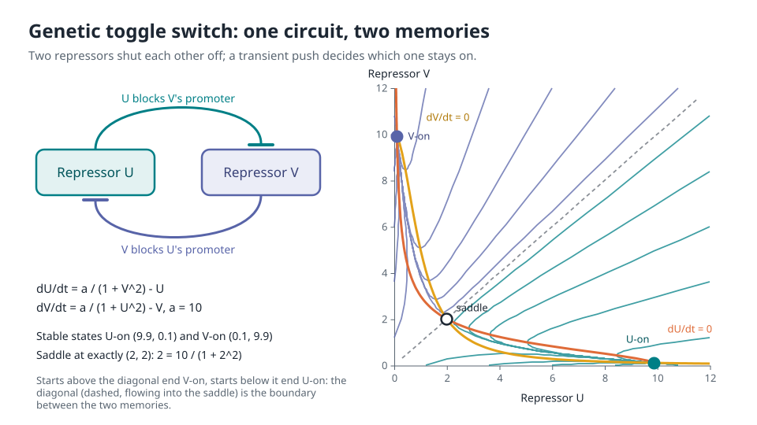 |  | 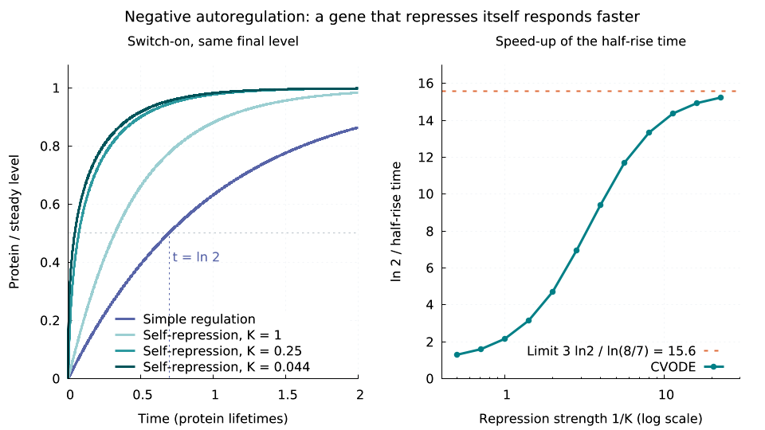 |
| Two repressors shut each other off; 22 starts settle into one of two stable states, split by a saddle at exactly (2, 2). | lacI, tetR and cI repress each other in a ring and oscillate with a period of 8.7 mRNA lifetimes; with Hill n = 1 the ring goes quiet. [Animation](docs/images/repressilator.gif) | A gene that represses itself reaches half its level up to 15.6x sooner than a simply regulated one; the limit is checked in closed form. |
| `lmctl https://raw.githubusercontent.com/lmctl-ai/lmbio/main/examples/toggle_switch.lms` | `lmctl https://raw.githubusercontent.com/lmctl-ai/lmbio/main/examples/repressilator.lms` | `lmctl https://raw.githubusercontent.com/lmctl-ai/lmbio/main/examples/negative_autoregulation.lms` |

| When a feedback loop starts to tick | Same mean, very different cells | One cell, one seeded trajectory |
| --- | --- | --- |
| 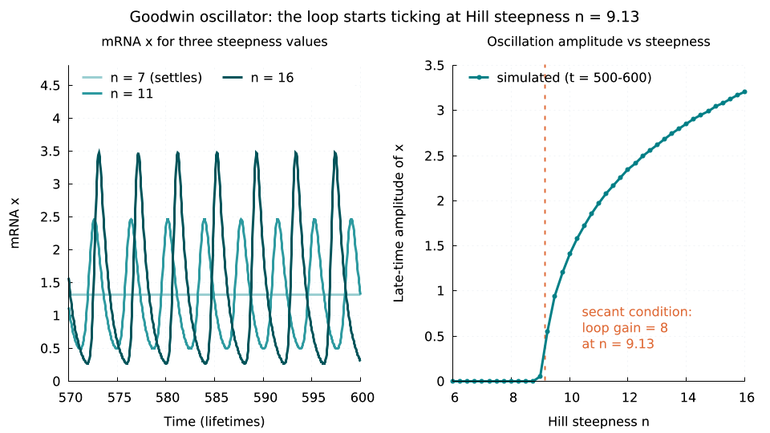 | 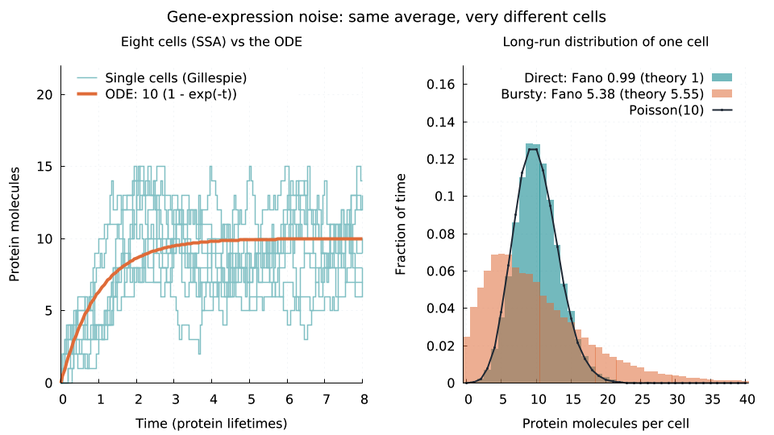 | 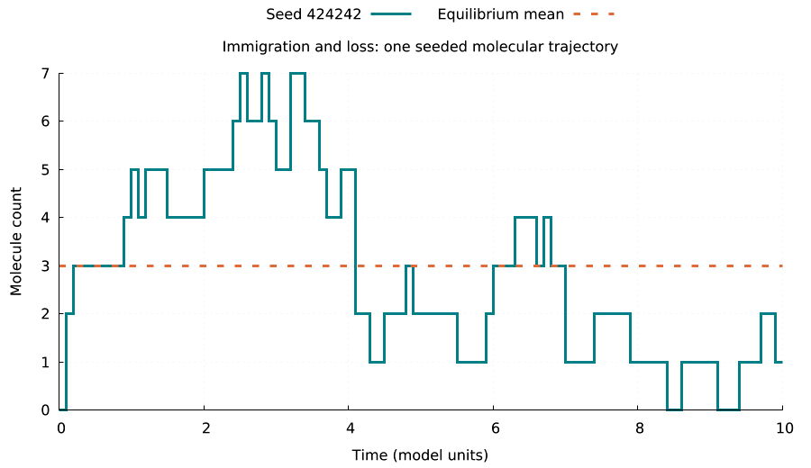 |
| The Goodwin loop oscillates once its gain passes 8 (the secant condition), at n = 9.13; a 41-point sweep shows the onset. | Direct production gives Poisson noise (Fano 1); bursty production from mRNA gives Fano 5.5 at the same mean. | Immigration and loss at low copy number: integer jumps around a mean of 3, reproducible from the seed. |
| `lmctl https://raw.githubusercontent.com/lmctl-ai/lmbio/main/examples/goodwin_threshold.lms` | `lmctl https://raw.githubusercontent.com/lmctl-ai/lmbio/main/examples/gene_noise.lms` | `lmctl https://raw.githubusercontent.com/lmctl-ai/lmbio/main/examples/stochastic.lms` |

### Enzymes, metabolism and chemistry

| Enzyme saturation | Feedback inhibition re-routes flux | Which rate constant matters, and when |
| --- | --- | --- |
| 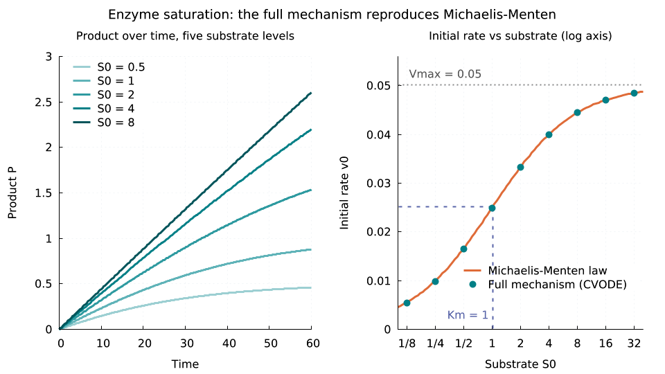 | 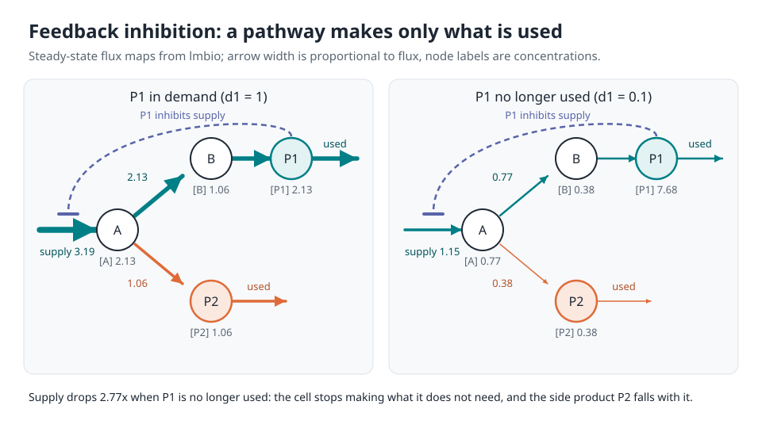 | 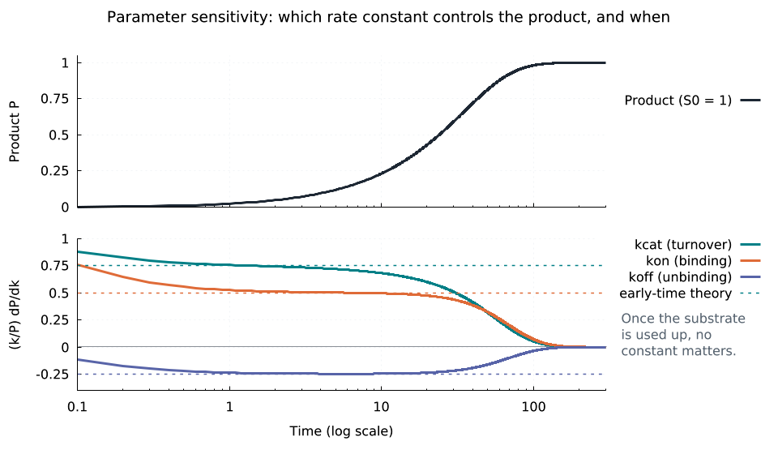 |
| The full E + S <-> ES -> E + P mechanism at nine substrate levels lands on Vmax S/(Km + S) with Km = 1 within 3%. | When the end product is no longer used it shuts its own supply: flux falls 2.8x, matching a closed-form quadratic. | Scaled sensitivities of the product to kcat, kon and koff start at 0.75, 0.5 and -0.25 and fade once substrate runs out. |
| `lmctl https://raw.githubusercontent.com/lmctl-ai/lmbio/main/examples/enzyme_saturation.lms` | `lmctl https://raw.githubusercontent.com/lmctl-ai/lmbio/main/examples/feedback_inhibition.lms` | `lmctl https://raw.githubusercontent.com/lmctl-ai/lmbio/main/examples/parameter_sensitivity.lms` |

| Robertson: stiff chemistry | Enzyme turns substrate into product | A cascade delays its product |
| --- | --- | --- |
| 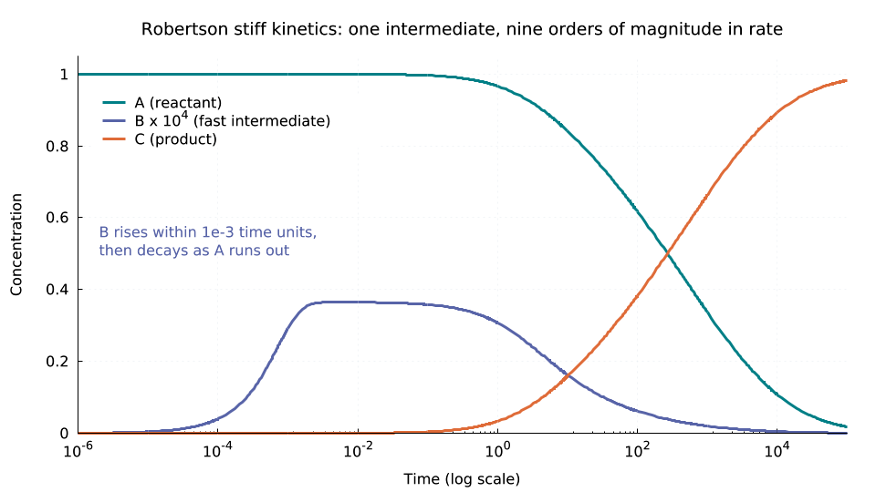 | 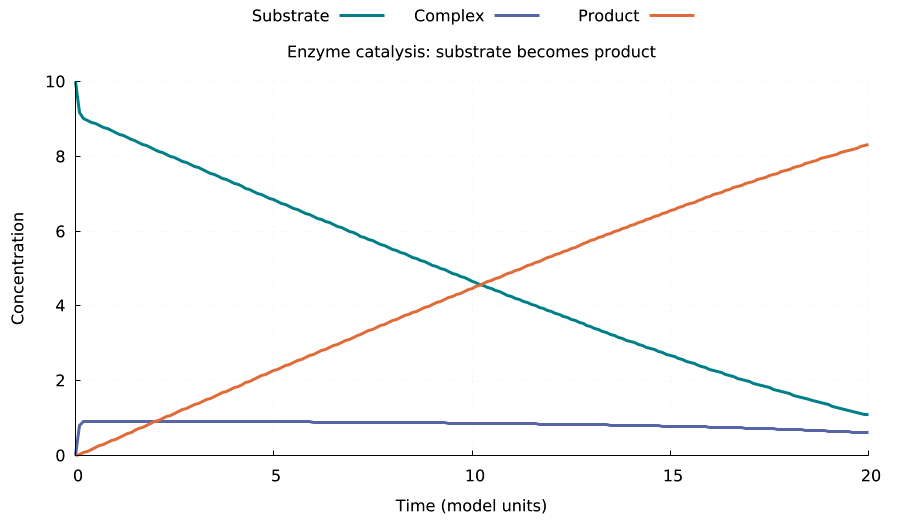 | 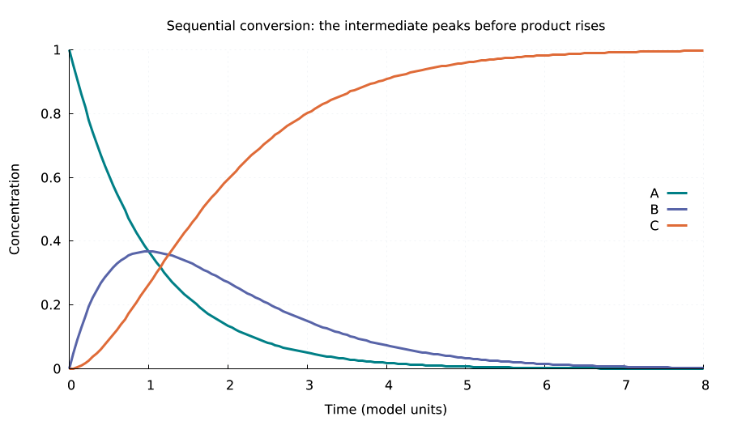 |
| Rate constants spanning nine orders of magnitude, integrated from 1e-6 to 1e5; checked against A(40) = 0.715827. | Substrate, complex and product of one mass-action enzyme with mass conservation checked. | A -> B -> C: the intermediate peaks at 1/e before the product takes over. |
| `lmctl https://raw.githubusercontent.com/lmctl-ai/lmbio/main/examples/robertson_switch.lms` | `lmctl https://raw.githubusercontent.com/lmctl-ai/lmbio/main/examples/biochemical_network.lms` | `lmctl https://raw.githubusercontent.com/lmctl-ai/lmbio/main/examples/cascade_delay.lms` |

### Medicine, epidemics and populations

| Dosing regimen design | Epidemic final size | Predator and prey |
| --- | --- | --- |
| 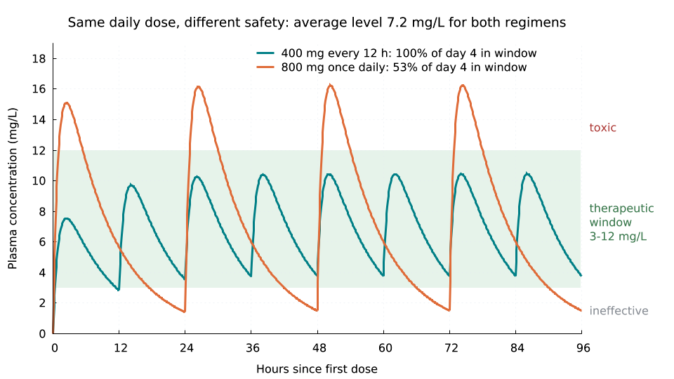 | 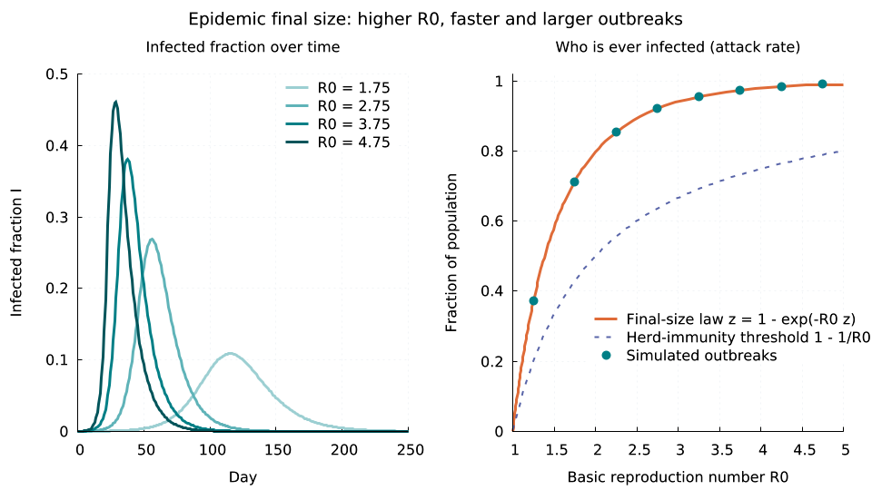 | 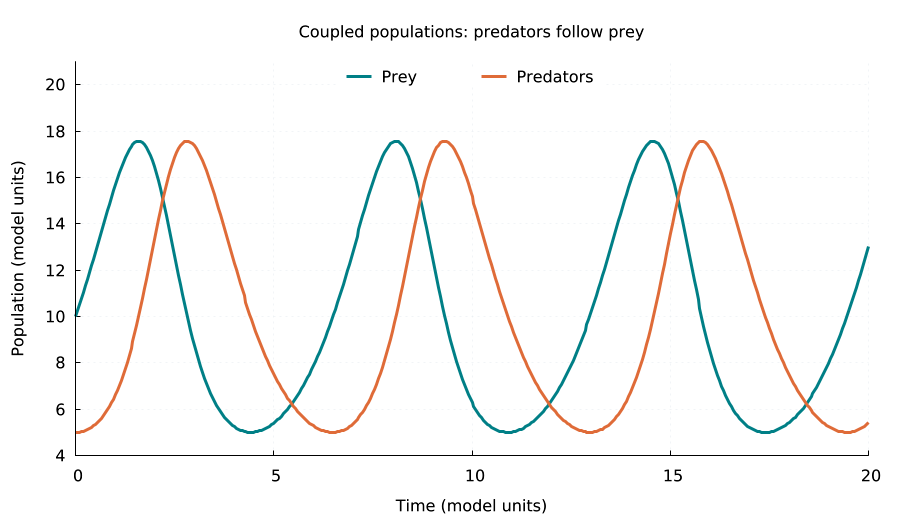 |
| 400 mg twice daily vs 800 mg once daily: same average level 7.2 mg/L, but only one regimen stays inside the 3-12 mg/L window. | SIR outbreaks for eight R0 values land on z = 1 - exp(-R0 z) and always overshoot herd immunity 1 - 1/R0. | Lotka-Volterra written as three reactions: predators follow prey around a closed cycle. |
| `lmctl https://raw.githubusercontent.com/lmctl-ai/lmbio/main/examples/pk_dosing.lms` | `lmctl https://raw.githubusercontent.com/lmctl-ai/lmbio/main/examples/sir_epidemic.lms` | `lmctl https://raw.githubusercontent.com/lmctl-ai/lmbio/main/examples/predator_prey.lms` |

| Crowding limits growth | Reversible chemistry finds equilibrium | Half-life as a molecular clock |
| --- | --- | --- |
| 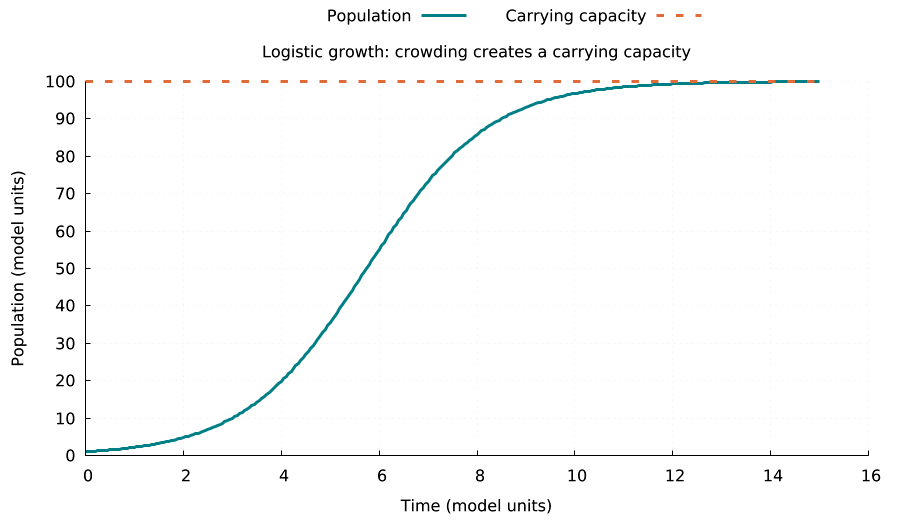 | 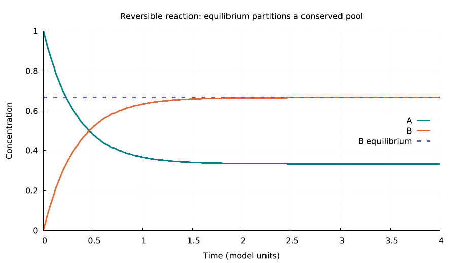 | 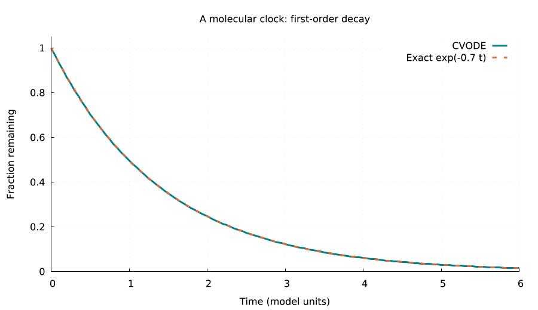 |
| Logistic growth as birth and crowding reactions settles at the carrying capacity of 100. | A <-> B with forward rate twice the reverse ends with B = 2/3 of the pool. | First-order decay matches exp(-0.7 t); the [animation](docs/images/decay_clock.gif) sweeps a time cursor. |
| `lmctl https://raw.githubusercontent.com/lmctl-ai/lmbio/main/examples/logistic_limit.lms` | `lmctl https://raw.githubusercontent.com/lmctl-ai/lmbio/main/examples/reversible_balance.lms` | `lmctl https://raw.githubusercontent.com/lmctl-ai/lmbio/main/examples/decay_clock.lms` |

Every example checks its own numbers against a known answer (a closed form, a textbook threshold, a conservation law) before it draws anything; a wrong result stops the run.

## Quickstart (1 minute)

```sh
npm install -g @lmctl-ai/lmctl
mkdir try-lmbio && cd try-lmbio
lmctl https://raw.githubusercontent.com/lmctl-ai/lmbio/main/examples/toggle_switch.lms
```

The run downloads the lmbio, lmplot and lmdraw release binaries on first use (Linux binaries require dynamic glibc >= 2.35, Ubuntu 22.04+), computes, checks, and prints `wrote images/toggle_switch.png`. Intermediate CSV files land in `build/examples/`. The animated examples also write a GIF when `ffmpeg` is on PATH (otherwise they print `SKIP` and keep the frames in `build/`).

If an unrelated program called `lmbio` is already on your PATH, lmscript picks it first and stops with `unexpected argument '--dsl-schema'`. Remove it from PATH or put this host's directory first; the host must answer `lmbio --dsl-schema --json`.

## Write your own model

```lmscript
p = _lmcode_ cli="lmbio" install="github:lmctl-ai/lmbio@latest";
let m = bio.model("conversion").compartment("cell", 1.0);
m.species("A", "cell", 1.0).species("B", "cell", 0.0);
m.param("k", 0.7).reaction("convert", "A -> B", "k*A");
let result = m.simulate(0.0, 4.0, 41);
bio.assert_close(result.final("A"), 0.060810062625, 0.000001);
bio.assert_close(result.final("A") + result.final("B"), 1.0, 0.000001);
result.save_csv("conversion.csv");
end _lmcode_
savedsl(p, "conversion.dslb");
r = system ${dsl_cli(p)} --dsl conversion.dslb;
assert(r.code == 0);
```

Save it as `conversion.lms` and run `lmscript conversion.lms`. The host CLI accepts `--dsl FILE...`, `--dry-run --dsl FILE...`, `--version`, `--notices`, `--dsl-schema [--json]` and `--dsl-signatures`. Usage errors exit 2; bytecode load/run errors exit 3. Dry run checks bytecode without running the model or writing files.

| API | Purpose |
| --- | --- |
| `bio.model(name)`, `bio.load_sbml(path)` | create or import a model |
| `model.compartment(id,size)` | fixed, positive compartment volume |
| `model.species(id,compartment,initial)` | initial concentration |
| `model.param(id,value)` | kinetic parameter |
| `model.reaction(id,"A + B -> 2 C","k*A*B")` | stoichiometry and rate expression; empty sides support sources/sinks |
| `model.reversible(id,"kr*C")` | add reverse rate to an existing reaction |
| `model.mass_action(id,"2 A -> D","k")` | mass-action law `k*V*A^2` for ODEs and propensity `k*A*(A-1)` for SSA, from one call (0.1.1) |
| `model.mass_action_reversible(id,"A + B -> C","kf","kr")` | the same with a mass-action reverse rate (0.1.1) |
| `model.rule(id,"expression")` | assignment rule |
| `model.rate_rule(id,"expression")` | differential rule |
| `model.set(id,value)`, `model.get(id)` | change/query initial species, parameter or compartment-size values (compartments from 0.1.1) |
| `model.set_state(result)` | restart from a result's last row, e.g. before a dose (0.1.1) |
| `model.tol(rtol,atol)`, `model.validate()` | configure error control and validate the network |
| `model.simulate(t0,t1,points)` | CVODE BDF time course |
| `model.steady_state()` | steady state with residual verification |
| `model.ssa(t1,points,seed)` | Gillespie direct simulation with an integer seed |
| `model.sensitivity(parameter,t0,t1,points,relative_step)` | central finite-difference derivatives |
| `model.save_sbml(path)` | write supported semantics as SBML L3V2 MathML |
| `result.value(id,row)`, `result.final(id)` | named values, zero-based rows |
| `result.rows/cols/get/column` | matrix dimensions, indexed values, column names |
| `result.max(id)`, `result.time_of_max(id)`, `result.min(id)` | sampled extremes and the first time of the maximum (`min` from 0.1.1) |
| `result.integral(id)` | trapezoid area under a column, e.g. drug exposure AUC (0.1.1) |
| `result.crossing(id,level)` | first time a column reaches a level, linearly interpolated (0.1.1) |
| `result.append(next)` | join consecutive runs; a jump at the joint (a dose) keeps both rows (0.1.1) |
| `result.save_csv(path)` | comma-separated matrix with header |
| `bio.assert_close(a,b,absolute_tolerance)`, `bio.assert_true(bool)`, `bio.print(text)` | script assertions and output |

Methods marked 0.1.1 were added in the v0.1.1 release.

Results contain `time`, species in creation order, then parameters in identifier order. Simulation does not change initial model values. CSV is the exchange format for other hosts. The DSL has no list/map/callback values; kinetic laws and rules are expression strings. Expressions support arithmetic, powers, scientific notation, and common elementary functions (`exp`, `log`, `sin`, `sqrt`, `min`, `max`, `sign` and others). DSL numeric literals themselves use decimal notation, and the DSL itself has `pow` and `sqrt` but no `exp`/`log` (write `pow(2.718281828459045, x)`).

## Limits

- **Semantics.** Kinetic laws are reaction extents (substance per time); a concentration species receives stoichiometry x rate / compartment volume. SBML `hasOnlySubstanceUnits` species use amounts. Boundary and constant species do not change through reactions. Local kinetic parameters shadow global symbols in their reaction. Assignment rules are evaluated in dependency order; cycles and unknown names are errors.
- **SBML subset, no conformance claim.** The reader handles SBML L3V1/V2 fixed compartments, species, parameters, reactions, local parameters, arithmetic MathML and assignment/rate rules. Packages, events, delays, algebraic rules, initial assignments, function definitions, piecewise, dynamic compartments and conversion factors are rejected with a message. Units are not converted or checked. The SBML Test Suite is LGPL and is not run. See [schema and semantics](durable-memory/03-schema-v0.md).
- **No events.** Doses, medium changes and other discontinuities are modelled by restarting a run from the previous end state (see `pk_dosing`); time-dependent inputs can use `min`, `max`, `sign` and `floor` in rate expressions, though such models cannot be exported to SBML.
- **SSA.** Species values are molecule counts in unit-volume compartments and rate expressions are propensities. Initial counts and stoichiometric coefficients must be nonnegative integers. Hand-written propensities must include combinatorics (`k*X*(X-1)` for `2 X ->`); `mass_action` writes them for you. No rules or explicit time dependence. A seed reproduces a trajectory byte for byte on the same platform; other platforms' math libraries can change it, so examples check statistics, not exact paths. `mass_action` propensities are not stored in SBML; a reloaded model uses its ODE law for SSA.
- **Sensitivities** are central finite differences of two extra CVODE runs, not CVODES forward sensitivities: pick a step that dominates solver error or tighten `tol()`.
- Model and result objects live until the host exits; long scans are bounded by the memory budget under Resource limits.

## Build and tests

```sh
scripts/sync-deps.sh
cmake -S . -B build -DCMAKE_BUILD_TYPE=Release
cmake --build build --parallel 4
./test.sh
examples/render-all.sh   # regenerate docs/images (network for lmplot/lmdraw; ffmpeg for GIFs)
```

Requires CMake 3.24+, C++17, git, Python 3, and lmscript for tests (`npm i -g @lmctl-ai/lmctl@0.2.420` or later). Linux releases link all scientific libraries and `libstdc++`/`libgcc` statically and use only dynamic glibc (>= 2.35); macOS uses only system libraries; Windows statically links MinGW runtimes. No external runtime data is required.

`test.sh` builds the host, runs the native regression tests (first-order decay, reversible equilibrium, mass-action enzyme conservation, Lotka-Volterra invariants, Robertson stiff kinetics, finite-difference sensitivities, stochastic Poisson moments, SBML round trips, mass-action propensities, dosing restarts), runs every example with its own known-answer assertions, checks that result files are byte-identical on rerun, and checks schema/registry/compiler parity, dependency pins, runtime linkage, error codes and the gallery (sources, PNG/GIF signatures, sizes). All fixtures are original MIT-licensed test data.

## Resource limits

A program may use at most 4096 MiB in total (models, results, solver state, SBML documents,
everything the host keeps); beyond that it stops with a run error (exit 3) naming the limit,
instead of exhausting the machine. Set `LMBIO_MAX_MEMORY_MB` to change it, e.g.
`LMBIO_MAX_MEMORY_MB=16384 lmscript scan.lms`.

## License

Our host and reaction code are [MIT](LICENSE). SUNDIALS 7.2.1 is BSD-3-Clause and pugixml 1.15 is MIT. Their pinned sources live only in ignored `third_party/`. Full notices are embedded in the binary (`lmbio --notices`) and supplied in [THIRD_PARTY_NOTICES](THIRD_PARTY_NOTICES), including the toolchain runtimes (static `libstdc++`/`libgcc` and MinGW, dynamic system glibc >= 2.35 on Linux). There is no libSBML, RoadRunner, LLVM, GPL or LGPL scientific dependency; see [license decisions](durable-memory/02-libraries-and-licenses.md). The figures are drawn by [lmplot](https://github.com/lmctl-ai/lmplot) and [lmdraw](https://github.com/lmctl-ai/lmdraw), installed separately at run time.
